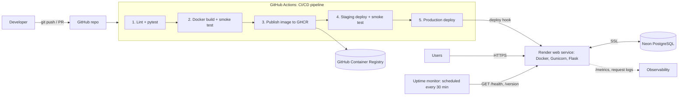

# Architecture

| Component | Role |
|---|---|
| GitHub Actions | Lint, test, build, publish, deploy |
| GHCR | Stores versioned Docker images (`latest` + commit SHA) |
| Render | Runs the container in production |
| Neon | Managed PostgreSQL database |
| Uptime monitor | Scheduled workflow that checks `/health` and `/version` |
